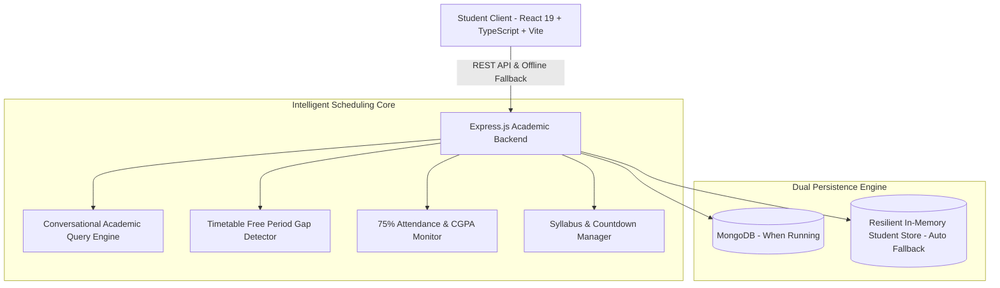

# STUDYFLOW AI 🎓
### Conversational AI Assistant for College Timetable & Study Planning 

> **Submission-Ready AI Academic Copilot** designed specifically for university students to eliminate scheduling confusion, detect free study gaps, automate revision time-blocking, and track exam readiness.

---

## 🌟 Product Overview

Traditional college portals are static tables that leave students to figure out when and what to study. **StudyFlow AI** transforms passive college timetables into an **active conversational copilot**.

### What It Solves:
1. **Scattered Lecture Tracking**: Students constantly ask where their next lecture or lab is.
2. **Wasted Free Periods**: 1–2 hour gaps between classes are lost to idle scrolling instead of targeted study sprints.
3. **Overlooked Deadlines**: Assignment and lab record submissions sneak up with zero proactive prioritization.
4. **Attendance Risk**: University mandatory 75% minimum attendance rules lead to last-minute exam disqualifications.
5. **Exam Revision Panic**: Lack of structured countdowns and syllabus unit tracking.

---

## ⚡ Core Modules

| Module | Core Capability |
| :--- | :--- |
| **🤖 Conversational Academic Copilot** | Natural language dialogue trained on the student's timetable and curriculum. Answers *"What's my next lecture and room?"*, *"Do I have free time to study today?"*, *"Generate a study plan for Data Structures"*, and *"What assignments are due this week?"*. |
| **📅 Dynamic College Timetable Matrix** | Visual Monday–Saturday schedule showing course codes (`CS501`, `CS502`, `MA501`), faculty, lecture halls (`LH 302`, `LH 101`, `Lab 4`), and auto-highlighted **Free Study Windows**. |
| **⏱️ Autonomous Study Planner & Pomodoro** | Maps free gaps between lectures to targeted revision blocks, paired with an interactive **Pomodoro Focus Timer** (`25:00`). |
| **📝 Assignments & Lab Tracker** | Prioritized coursework tracker with countdown deadlines, priority badges (High / Medium / Low), and 1-click completion toggles. |
| **🎯 Semester Exam Countdown Matrix** | Real-time days-remaining ticker and syllabus unit revision progress tracking (`4 / 5 Units (80%)`). |
| **📊 Academic Telemetry & Attendance Guard** | Proactively monitors the university **75% mandatory attendance threshold** per subject with early-warning alerts. |

---

## 🚀 Quick Start for Teammates & Evaluators

### Prerequisites:
- **Node.js** (v18 or higher) — [Download Node.js](https://nodejs.org/)
- **Git**

> [!IMPORTANT]
> **Is MongoDB required? NO!**
> MongoDB is **100% OPTIONAL**. The backend includes an **Automated In-Memory Data Store** pre-loaded with realistic student data (Ram Malhotra, 24Z999, CSE 5th Semester). If MongoDB is not running, the application automatically boots in demo mode with zero crashes.

---

### Option 1: 1-Click Automated Setup (Windows)

Just double-click or run:
```cmd
setup.bat
```
*(On macOS/Linux: `./setup.sh`)*

---

### Option 2: Manual Installation (3 Steps)

#### 1. Clone the repository
```bash
git clone <repository_url>
cd <folder_name>
```

#### 2. Install dependencies
```bash
# Install root dependencies
npm install

# Install backend dependencies
cd backend
npm install
cd ..

# Install frontend dependencies
cd frontend
npm install
cd ..
```

#### 3. Run the product
Open **two terminals**:

* **Terminal 1 (Backend API on Port 5000)**:
  ```bash
  cd backend
  npm run dev
  ```

* **Terminal 2 (Frontend App on Port 3000)**:
  ```bash
  npm run dev
  ```

* Open your browser and navigate to: **[http://localhost:3000/](http://localhost:3000/)**

---

## 👨‍🎓 Pre-Loaded Demo Student Profile

The application comes pre-authenticated and pre-seeded for demo evaluations:
* **Student Name**: Ram Malhotra
* **Roll Number**: `24Z999`
* **Department**: Computer Science & Engineering
* **Semester**: Semester 5
* **CGPA**: 8.64
* **Sample Courses**: Data Structures & Algorithms, Operating Systems, DBMS Lab, Discrete Mathematics, Theory of Computation, Computer Networks.

---

## 💬 Sample Inquiries to Try in the AI Assistant

Click on any quick prompt or type:
* *"What is my next class and room?"*
* *"Do I have any free time to study today?"*
* *"Generate a study plan for Data Structures"*
* *"What assignments are due this week?"*
* *"How is my attendance across subjects?"*
* *"When is my Operating Systems exam?"*

---

## 🏗️ Architecture



---

## 🛠️ Tech Stack

* **Frontend**: React 19, TypeScript, Vite, Tailwind CSS, Lucide Icons, Canvas Stars.
* **Backend**: Node.js, Express.js, TypeScript, REST APIs.
* **Database**: MongoDB driver with resilient In-Memory Mock Store fallback.
* **Security & Auth**: JWT token support, CORS protection, sanitize middleware.
* **Design System**: Dual Theme (Cyber Neon & Royal Obsidian) with custom responsive viewport architecture.
